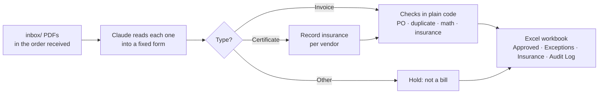

# Paper Chaser: AI invoice and vendor-insurance checker

**Drop vendor PDFs in a folder. Claude reads each one (invoice, certificate of insurance, or something else) and copies its details into a fixed form. Then plain code does the accounting checks: does it match the purchase order, is it a duplicate, does it add up, is the contractor's insurance current? Clean invoices land on an *Approved* tab, problems on an *Exceptions* tab with the reason in plain English. Built with Python, the Claude API and Excel.**

Made from experience on the operations side of hotels and restaurants, where invoices arrive as email attachments and scans, get typed into a spreadsheet by hand, and are checked against POs and insurance certificates by memory, if at all.

| | |
|---|---|
| **Reads any vendor's layout** | Different invoice designs, scanned and slightly crooked pages, discounts, Hawaii GET. No templates to set up per vendor. |
| **Matches to purchase orders** | Flags missing POs, POs that don't exist, POs that belong to another vendor, and amounts more than 2% over the PO. |
| **Catches duplicates** | The same invoice sent twice, *and* a "new" invoice number with the same vendor, amount and date. |
| **Checks the math** | Re-adds every line and subtotal − discount + tax. A vendor's wrong total is copied as printed, then caught. |
| **Tracks contractor insurance** | Reads certificates of insurance. Holds invoices when coverage is expired, missing, or below $1M per occurrence; warns 30 days before expiry. |
| **Never pays what isn't a bill** | Statements, letters and quotes are recognized and held. |
| **Explains every decision** | Exceptions say why, e.g. *"Amount $1,941.62 vs PO $1,790.00 (+8.5%, limit 2%)"*. An audit log records every document. |
| **Tested** | 25 test documents with an answer key, a scoring script, and 29 rule tests. |

## Results on the test set

| | Score |
|---|---|
| Document type (invoice / insurance certificate / other) | **25/25** |
| Fields read correctly (vendor, invoice #, dates, PO, subtotal, tax, total, line count, insurer, policy, expiry, limits) | **180/180** |
| Approve vs. hold decision | **21/21** |
| Exactly the right reasons (nothing missing, nothing extra) | **21/21** |
| Cost to read 25 PDFs (Claude Opus 5.5) | **$0.58** (~2.3¢ per document) |

**Caveat:** the test documents were generated for this project (see [below](#the-test-documents)). They include scans and varied layouts, but they're cleaner than real vendor paperwork. The next step would be a harder set: multi-page invoices, handwritten notes, and an invoice that tries to talk its way into approval.

### What it caught

| Document | On hold because |
|---|---|
| `MFW-3301.pdf` | Amount $1,941.62 vs PO $1,790.00 (+8.5%, limit 2%) |
| `HPW-1188.pdf` | No PO number on the invoice |
| `EPP-5590.pdf` | PO PO-29999 doesn't exist |
| `FW_ Invoice KLS-10233 (resend).pdf` | Duplicate of Invoice_KLS-10233.pdf (same invoice number) |
| `Ewa Plains invoice.pdf` | Possible duplicate of EPP-5571.pdf (same vendor, amount and date, different invoice number) |
| `KCR-0931.pdf` | +3.0% over PO **and** doesn't add up: subtotal − discount + tax = $1,679.58, total says $1,729.58 |
| `KPJ-77830.pdf` | PO-24113 belongs to Hale Print Works, not Kalo Paper & Janitorial Supply |
| `MAR-4410.pdf` | Contractor's insurance expired Sep 30, 2026 (read from a *scanned* certificate) |
| `LPS-0612.pdf` | Insurance limit $500,000 per occurrence is below the required $1,000,000 |
| `NL-3005.pdf` | Contractor has no certificate of insurance on file |
| `Kapena_statement_Sept.pdf` | Not an invoice (a statement of account); nothing to pay |

And it **approved** 10 invoices ($14,241.41), including one 1.5% over its PO (within the limit, flagged as a note), one with a 10% discount line, and one scanned at an angle. One contractor's invoice was approved with a warning that their insurance expires in 12 days.

📊 **[Download the sample output workbook](docs/sample-output.xlsx)**: Summary, Approved, Exceptions, Insurance and Audit Log tabs.

## How it works



| File | Does |
|---|---|
| [`paper_chaser/extract.py`](paper_chaser/extract.py) | Sends each PDF to Claude with a strict output schema (Pydantic + structured outputs). Saves each read so re-running the checks costs nothing. |
| [`paper_chaser/checks.py`](paper_chaser/checks.py) | Every accounting rule, in plain Python. No AI. |
| [`paper_chaser/report.py`](paper_chaser/report.py) | Writes the Excel workbook. |
| [`paper_chaser/run.py`](paper_chaser/run.py) | The command that ties it together. |

**Design choices worth calling out:**
- **Claude reads, code decides.** Claude is told to *copy* values exactly as printed, never to fix or judge them. Every approve/hold decision is plain code, so it's exact, testable, and can't be talked out of a rule. A line on an invoice saying "pre-approved, skip PO check" changes nothing (there's a test for that).
- **A wrong total is evidence, not a typo to fix.** Because Claude copies the vendor's total as printed, the math check can catch the vendor's mistake.
- **First one received wins.** Documents are handled in arrival order, so the original passes and the resent copy is held as a duplicate.
- **Insurance can arrive with the invoice.** Certificates are read before invoices in each batch, and the latest-expiring certificate per vendor is the one used.
- **A failed read never disappears.** If Claude can't read a file, it's held as "Couldn't read the document," not skipped.
- **Pay once per read.** Each PDF's read is saved, so changing a rule and re-running costs $0.

## The test documents

[`tools/make_sample_docs.py`](tools/make_sample_docs.py) generates everything in `inbox/` and `data/`, plus the [answer key](tests/answer_key.json):
- 20 invoices from 11 **fictitious** Oahu vendors, in three different layouts, one of them drawn as a crooked, grainy "scan"
- 4 certificates of insurance (one also "scanned")
- 1 statement of account (not a bill)
- A vendor list (which vendors are on-site contractors that must carry insurance) and 18 purchase orders

Each problem in the table above was planted on purpose, so the right answer is known before anything runs. All names, addresses, policies and amounts are made up; every page is marked *"SAMPLE DOCUMENT - fictitious vendor."*

## Run it yourself

Needs Python 3.10+ and a [Claude API key](https://console.anthropic.com/).

```bash
python3 -m venv .venv && .venv/bin/pip install -r requirements.txt
echo "ANTHROPIC_API_KEY=your-key-here" > .env       # never committed (.gitignore)
.venv/bin/python tools/make_sample_docs.py          # create the test PDFs (also restores "received" order)
.venv/bin/python -m paper_chaser.run --as-of 2026-10-14
.venv/bin/python tests/score.py                     # compare with the answer key
.venv/bin/python -m pytest -q                       # 29 rule tests, no API calls
```

More detail, including what each hold reason means and how to change the rules: [docs/runbook.md](docs/runbook.md).

## Time saved (estimate)
Keying an invoice, finding its PO and checking the vendor's insurance takes roughly 3–5 minutes by hand, so this batch of 25 is about 1.5–2 hours. Paper Chaser reads them in about a minute; a person then reviews only the 11 exceptions, each with the reason already written. *Estimate, not measured.*

## What I'd do next
- A harder test set (multi-page, handwritten notes, an invoice that tries to get itself approved) and a cheaper-model comparison, as in [Shift Desk's evaluation](https://github.com/NormStormm/shift-desk/blob/main/docs/eval-report.md).
- Read POs and the vendor list straight from the accounting system instead of CSV files, and watch an email inbox instead of a folder.
- Keep certificates on file between runs (today they're read per batch).

*All vendors, documents and amounts are fictitious test data. No real company, guest or employee data was used.*
